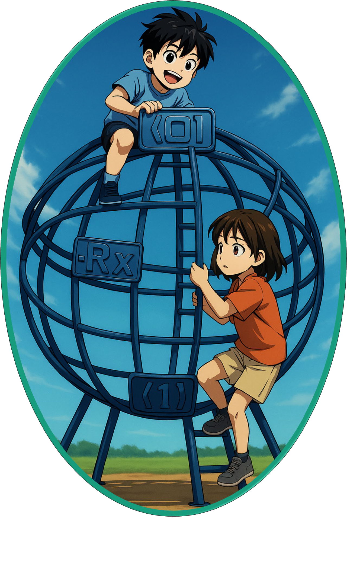
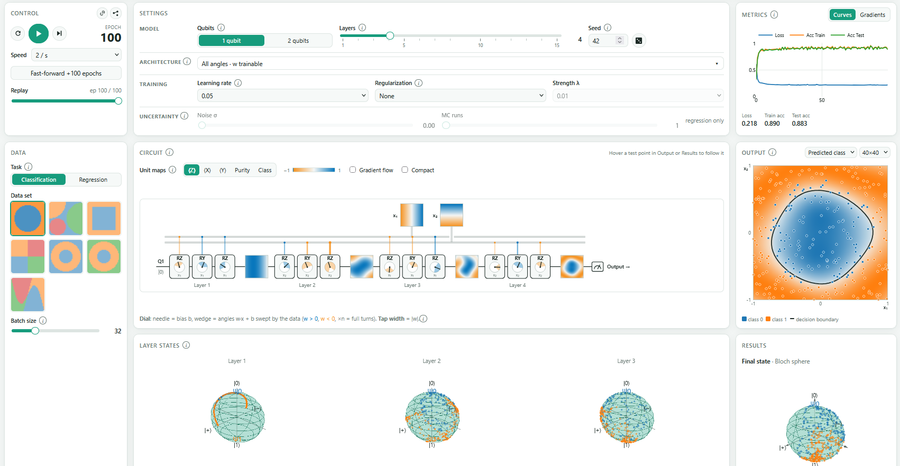

[](https://doi.ieeecomputersociety.org/10.1109/MCG.2024.3456288)
[](https://arxiv.org/abs/2507.17931)

<p align="center">
  
</p>

# Quantum Machine Learning Playground

The **Quantum Machine Learning (QML) Playground** is an interactive web application for visualizing and exploring the inner workings of quantum machine learning models in an intuitive, educational way. Inspired by classical tools like TensorFlow Playground, it focuses on parameterized quantum circuits (PQCs), in particular the *data re-uploading universal quantum classifier*. It uses visual metaphors such as Bloch spheres and the **Q-simplex** to interpret how quantum states evolve.

The playground covers **classification and regression**, **regularization** and **uncertainty quantification**. It runs **entirely in your browser**: the quantum simulator, training and all visualizations are client-side, with no server and no installation.

It is meant for learners, educators and researchers who want to explore QML models without deep expertise in quantum hardware or simulators.

---

## 🌐 Live Demo

<p align="center">
  
</p>

👉 **[Try the Live Demo](https://fraunhofer-aisec.github.io/qml-playground/)**

No installation required: ideal for quick experiments, teaching and outreach.

---

## 🧠 How the Quantum Model Works

The playground demonstrates the **data re-uploading variational quantum model** introduced by Pérez-Salinas et al. ([Quantum, 2020](https://quantum-journal.org/papers/q-2020-02-06-226/)). Every layer applies trainable rotations Rot(φ, θ, ω) = RZ(ω)·RY(θ)·RZ(φ) whose angles are set to w·x + b, so the classical input is embedded again in every layer, much like depth in a classical neural network. With two qubits, an entangling gate follows each layer.

This model was chosen because it is:

* Structurally similar to common **variational quantum circuit (VQC)** architectures
* **Simple enough to visualize** intuitively
* **Powerful enough to be universal**, able to approximate any function in principle
* Well suited to illustrate **training dynamics**, **regularization effects**, **uncertainty estimates** and the model's **Fourier-series** nature

---

## ✨ Features

### 🧩 Models and data

* 🧠 **Real-time training** of 1- and 2-qubit circuits with 1–15 layers (Adam, mini-batches, adjustable learning rate)
* 🎯 **Classification** on seven 2-D datasets (circle, 3 circles, square, 4 squares, crown, tricrown, wavy lines)
* 🔢 **Regression** on Fourier series of degree 1–5, with gaps in the training data
* ⚖️ **L1/L2 regularization** to study overfitting and smoothness
* 🌫️ **Uncertainty quantification** for regression: Monte Carlo sampling with noisy parameters, shown as a ±2σ band
* 🏗️ **Architecture options**: CNOT, CZ or no entangler; data uploaded on all angles or on RY only; trainable or fixed (w = π) data weights

### 🔍 Seeing inside the circuit

* 🧩 **Interactive circuit view** in the style of TensorFlow Playground: every gate shows its angle as a dial, data taps show how strongly each feature is uploaded, and **unit maps** show the Bloch components, purity, entanglement or the would-be prediction after every layer over the whole input space
* 🔎 **Gate details**: click a gate for its parameters, current gradients and a histogram of its angle over the training data
* 🧭 **Follow a sample**: hover a test point to trace it through the circuit, as a path on the Bloch sphere or in the Q-simplex, on every dial and on every unit map
* 🌐 **Visual metaphors** for quantum states: the Bloch sphere for one qubit, the Q-simplex for two qubits and entanglement

### 📊 Results and diagnostics

* 🗺️ **Decision map** with the decision boundary, or the score of a single class
* 📈 **Regression fit** with uncertainty band, and the **Fourier spectrum** of the model against the target
* 📉 **Learning curves**, plus per-layer **gradient-norm** and **entanglement heatmaps** over training
* 🌊 **Gradient-flow view** in the circuit that reveals layers and gates that barely learn

### 🎛️ Usability

* ⏯️ Play, step, training speed and fast-forward, plus **replay** of any past epoch and resuming from it
* 🔗 **Shareable links** with the settings, optionally including the trained parameters
* 🌗 Light and dark mode; responsive layout

---

## 🚀 Getting Started

Requires [Node.js](https://nodejs.org/) 20+.

```bash
git clone https://github.com/fraunhofer-aisec/qml-playground
cd qml-playground/web
npm install
npm run dev        # http://localhost:5173/
```

Other commands:

```bash
npm test           # Vitest suites (simulator, gradients, trainer, parity with the PyTorch reference)
npm run lint
npm run build      # static site in web/dist/
npm run preview    # serve the build
```

The web app is a static site. `.github/workflows/pages.yml` builds, tests and deploys it to **GitHub Pages** on every push to `main`. See [`web/README.md`](web/README.md) for the architecture, deployment and the differences from the reference implementation.

---

## 🗂️ Repository Layout

```
web/       the QML Playground (Vite + React + TypeScript + Plotly.js), main version
legacy/    the original Plotly Dash + PyTorch app with its Docker/nginx setup (legacy)
```

### 🐍 Legacy Dash version

The original server-based version (Python, Dash, PyTorch) lives in [`legacy/`](legacy/). It is no longer the main version, but it is kept as the numerical reference for the web app's tests and for existing Docker deployments. Installation, local development and Docker instructions are in [`legacy/README.md`](legacy/README.md).

---

## 📚 Citation

If you use this tool in your research or presentations, please cite:

> P. Debus, S. Issel, and K. Tscharke, "Quantum Machine Learning Playground," *IEEE Computer Graphics and Applications*, vol. 44, no. 05, pp. 40–53, Sept.–Oct. 2024.
> DOI: [10.1109/MCG.2024.3456288](https://doi.ieeecomputersociety.org/10.1109/MCG.2024.3456288)

The arXiv version of this paper is available here: [2507.17931](https://arxiv.org/abs/2507.17931)

---

## 🙋 Maintainer

Developed and maintained by **[Pascal Debus](https://github.com/pdebus)**, [Quantum Security Technologies (QST)](https://www.aisec.fraunhofer.de/en/fields-of-expertise/CST/QST.html), Fraunhofer AISEC.

If you find this work useful, feel free to connect or reach out for collaboration opportunities!
